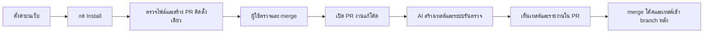
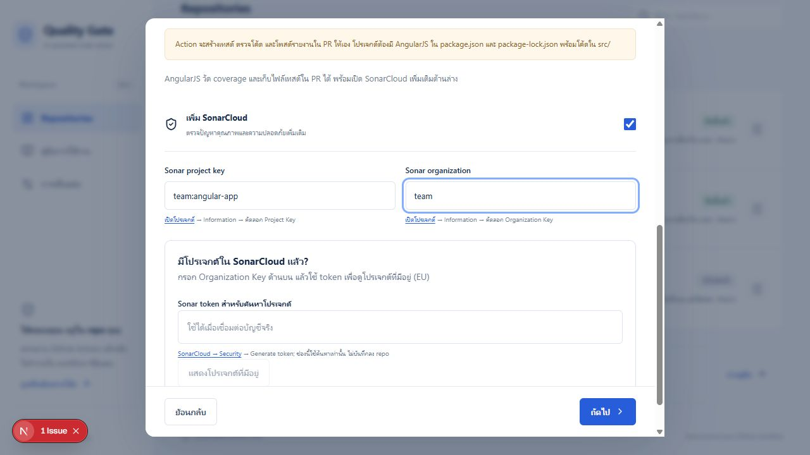

# Automated Quality Gate · Web UI

เว็บสำหรับเชื่อมต่อ GitHub ตั้งค่า AI และติดตั้งระบบตรวจคุณภาพโค้ดผ่าน Pull Request

ผู้ใช้ตั้งค่าผ่านเว็บ ส่วนการวิเคราะห์โค้ด สร้างเทสต์ วัด coverage และรายงานผล ทำงานบน GitHub Actions ใน repository ของผู้ใช้

## สารบัญ

- [ภาพรวมระบบ](#ภาพรวมระบบ)
- [ความสามารถ](#ความสามารถ)
- [เริ่มใช้งานในเครื่อง](#เริ่มใช้งานในเครื่อง)
- [ตั้งค่า GitHub App](#ตั้งค่า-github-app)
- [วิธีติดตั้งใน repository](#วิธีติดตั้งใน-repository)
- [การตั้งค่า AI และ API keys](#การตั้งค่า-ai-และ-api-keys)
- [เทสต์และ coverage](#เทสต์และ-coverage)
- [Deploy](#deploy)
- [ข้อจำกัดและการแก้ปัญหา](#ข้อจำกัดและการแก้ปัญหา)
- [สำหรับผู้พัฒนา](#สำหรับผู้พัฒนา)

## ภาพรวมระบบ

ระบบแบ่งเป็นสอง repository ที่ทำงานร่วมกัน:

| ส่วน | หน้าที่ |
| --- | --- |
| **Web UI — repository นี้** | Login ด้วย GitHub เลือก repo ตั้งค่า AI บันทึก secrets และสร้าง PR ติดตั้ง |
| [**Quality Gate Action**](https://github.com/NonnaritRammaneekultawat-6609650459/test-github-marketplace) | วิเคราะห์โค้ด สร้างและรันเทสต์ วัด coverage เพิ่มเทสต์เข้า PR และโพสต์รายงาน |



## ความสามารถ

- แสดง repository ที่บัญชีผู้ใช้และ GitHub App มีสิทธิ์เข้าถึงร่วมกัน
- รองรับ **JavaScript/Jest** และ **AngularJS 1.x** ตามโครงสร้างที่ระบบรองรับ
- กำหนดชื่อโมเดลเอง ใช้ Gemini API หรือบริการแบบ OpenAI-compatible Chat Completions
- บันทึก API keys แบบเข้ารหัสไปยัง GitHub Repository Secrets
- **Install ปุ่มเดียว**: ตรวจและรวมไฟล์เตรียมโปรเจกต์ workflow และ coverage config ใน PR เดียว
- แสดงสถานะไฟล์ติดตั้งบน default branch พร้อมปุ่มรีเฟรช
- มีโหมดข้อมูลตัวอย่างใน workspace ซึ่งไม่สร้าง PR หรือรับ key จริง

> การเชื่อมต่อ GitHub App ยังไม่ใช่การติดตั้ง workflow และการติดตั้งสำเร็จยังไม่ใช่การยืนยันว่าคุณภาพโค้ดผ่าน

## เริ่มใช้งานในเครื่อง

### 1. เตรียมเครื่อง

ใช้ Node.js 22 ขึ้นไป และ npm

```powershell
npm ci
Copy-Item .env.example .env.local
```

### 2. ใส่ค่าตั้งค่า

แก้ `.env.local` โดยใช้ค่าจาก GitHub App ของคุณ:

```dotenv
APP_URL=http://localhost:3000
GITHUB_CLIENT_ID=
GITHUB_CLIENT_SECRET=
GITHUB_APP_SLUG=
SESSION_SECRET=
```

| ตัวแปร | ความหมาย |
| --- | --- |
| `APP_URL` | URL ของเว็บ ต้องตรงกับ hostname/port ที่เปิดใช้ |
| `GITHUB_CLIENT_ID` | Client ID ของ GitHub App |
| `GITHUB_CLIENT_SECRET` | Client secret ของ GitHub App |
| `GITHUB_APP_SLUG` | ชื่อ slug ที่อยู่ใน URL ของ GitHub App |
| `SESSION_SECRET` | ค่าสุ่มสำหรับเข้ารหัส session อย่างน้อย 32 ตัวอักษร |

สร้าง session secret ได้ด้วย:

```powershell
node -e "console.log(require('crypto').randomBytes(32).toString('base64'))"
```

คัดลอกผลลัพธ์ไปใส่ใน `SESSION_SECRET` อย่าส่งค่าความลับลงแชตหรือ commit `.env.local`

### 3. เปิดเว็บ

```powershell
npm run dev
```

เปิด [http://localhost:3000](http://localhost:3000) และเข้าสู่ระบบด้วย GitHub หลังเปลี่ยน environment variables ให้ restart เซิร์ฟเวอร์

## ตั้งค่า GitHub App

สร้าง **GitHub App** ที่ [GitHub App settings](https://github.com/settings/apps) แล้วตั้งค่าสำหรับเครื่องพัฒนา:

| ช่อง | ค่า |
| --- | --- |
| Homepage URL | `http://localhost:3000` |
| Callback URL | `http://localhost:3000/api/auth/callback` |
| Setup URL | `http://localhost:3000/api/github/return` |
| Redirect on update | เปิด |
| Request user authorization during installation | ปิด — เว็บใช้ลำดับ Login ก่อนเลือก repo |

ตั้ง Repository permissions ให้รองรับการทำงานของเว็บ:

| Permission | สิทธิ์ที่ต้องใช้ |
| --- | --- |
| Contents | Read and write |
| Pull requests | Read and write |
| Workflows | Write ตามตัวเลือกที่ GitHub แสดง |
| Secrets | Read and write |
| Metadata | Read |

หากเปลี่ยน permissions ของ App ให้เจ้าของ installation อนุมัติสิทธิ์ใหม่ด้วย รุ่นนี้ไม่ต้องใช้ webhook หรือ App private key

ใช้ hostname ให้ตรงกันทุกจุด เช่น `localhost` ทั้งหมด อย่าสลับกับ `127.0.0.1` ระหว่าง Login

## วิธีติดตั้งใน repository

### ขั้นตอนสำหรับผู้ใช้

1. เข้าสู่ระบบ แล้วอนุญาต GitHub App ให้เข้าถึง repository งาน
2. เลือก repo และชนิดโปรเจกต์
3. ตั้งค่า AI, เป้าหมาย coverage และ SonarCloud หากต้องการใช้ ทั้ง JavaScript และ AngularJS
4. บันทึก API key ในขั้นเชื่อมต่อบริการ
5. กด **Install / อัปเดต** เพียงครั้งเดียว
6. เปิด PR ที่เว็บสร้าง ตรวจไฟล์ แล้ว merge ด้วยตนเอง
7. เปิด PR งานจาก branch ที่อัปเดตแล้ว เพื่อเริ่มตรวจโค้ด

### ระบบทำอะไรเมื่อกด Install?

| สิ่งที่ตรวจพบ | การทำงาน |
| --- | --- |
| ขาดไฟล์ที่ระบบเตรียมให้ได้ | เพิ่มไฟล์นั้นใน PR ติดตั้ง |
| มีไฟล์เดิมที่ใช้ได้ | เก็บของเดิมไว้ |
| ต้องอัปเดตตามค่าที่เลือก | เสนอการแก้ใน PR เช่น workflow และ coverage threshold |
| พบโครงสร้างหรือ dependencies ที่จัดการอัตโนมัติไม่ได้ | แจ้งเหตุผล โดยไม่เขียนทับแบบเดา |

**ไม่มี PR เตรียมโปรเจกต์แยกก่อน และไม่มีปุ่ม Force install** การตรวจความพร้อมทำหลังคลิก Install โดยยังรักษา dependencies, scripts และ test config เดิมที่ใช้ได้

### ไฟล์ที่ติดตั้ง

| ชนิดโปรเจกต์ | ไฟล์หลัก |
| --- | --- |
| JavaScript/Jest | workflow, `config_cov.json` และ package/lockfile/Jest config ที่จำเป็นต้องเพิ่ม |
| AngularJS | workflow, `config_cov.json` และชุดเครื่องมือแยกใน `quality-gate/` |
| JavaScript หรือ AngularJS ที่เปิด SonarCloud | เพิ่ม `sonar-project.properties` |

AngularJS ยังต้องมี dependencies ของแอปและ root lockfile ที่ถูกต้อง เว็บไม่สร้าง dependencies ของแอปจากการคาดเดา

เมื่อติดตั้งแล้ว การเปลี่ยนค่าและกด Install อีกครั้งจะสร้าง PR อัปเดต ไม่มีการ merge หรือแก้ default branch โดยตรง

## การตั้งค่า AI และ API keys

| รูปแบบ | สิ่งที่กรอก | Repository secret |
| --- | --- | --- |
| Gemini API | ชื่อโมเดล; ค่าเริ่มต้นในโค้ดคือ `gemini-3.1-flash-lite` | `GEMINI_API_KEY` |
| OpenAI-compatible | ชื่อโมเดลและ HTTPS Chat Completions URL แบบเต็ม | `AI_API_KEY` |
| SonarCloud สำหรับ JavaScript / AngularJS | Organization และ Project key | `SONAR_TOKEN` |

การค้นหาโปรเจกต์ SonarCloud ผ่านเว็บรองรับภูมิภาค EU (`sonarcloud.io`) และไม่ใช่การสร้างโปรเจกต์ใหม่

เมื่อเปิด SonarCloud ให้ปิด Automatic Analysis และตั้งให้วิเคราะห์ผ่าน GitHub Actions เตรียม Project Key, Organization และ Token ที่มีสิทธิ์วิเคราะห์ repo นั้น โดยโปรเจกต์และแพ็กเกจต้องรองรับ PR analysis และมีผลวิเคราะห์ branch หลักเป็นฐานแล้ว

Workflow เพิ่ม job `sonar` แยกจากการรันเทสต์ รับ LCOV จาก `coverage/lcov.info` สำหรับ JavaScript หรือ `coverage/quality-gate/lcov.info` สำหรับ AngularJS แล้วรายงานผลใน Security Audit ของ PR ระบบผูกผล Quality Gate กับ task ของการสแกนรอบนั้น หากสแกนไม่สำเร็จจะแสดง UNAVAILABLE และไม่ถือว่าผ่าน แต่ยังเก็บผลเทสต์และเพิ่มไฟล์เทสต์ใน PR ได้



Repo ที่ติดตั้งอยู่แล้วต้องเปิดการตั้งค่า เลือก AngularJS และ SonarCloud บันทึก Token แล้วกด Install เพื่อสร้าง PR อัปเดต จากนั้นตรวจและ merge PR ก่อนเปิด PR งานรอบใหม่

ตัวอย่างรูปแบบ URL สำหรับบริการอื่น:

```text
https://your-provider.example/v1/chat/completions
```

- ไม่ล็อกรายชื่อโมเดล แต่บริการต้องใช้รูปแบบ API ที่ระบบรองรับ
- ไม่รองรับ API ทุกชนิด เช่น Anthropic Messages หรือ OpenAI Responses โดยตรง
- URL ต้องเข้าถึงผ่านอินเทอร์เน็ตได้ ไม่ใส่ key ใน URL และไม่ใช้ redirect หรือ IP ภายใน
- Key ผ่าน backend ชั่วคราวเพื่อเข้ารหัสและส่งไป GitHub ไม่เก็บในฐานข้อมูล, localStorage หรือ export
- การบันทึกสำเร็จยืนยันว่าเก็บ secret แล้ว ไม่ได้ยืนยันว่า key หรือโมเดลใช้งานได้
- เมื่อ workflow รัน โค้ดจะถูกส่งไปยังบริการที่ผู้ใช้เลือก และใช้โควตา/ค่าใช้จ่ายของบัญชีนั้น
- หากใช้งานไม่ได้ ระบบรายงานข้อผิดพลาดและไม่เปลี่ยนโมเดลให้เอง

## เทสต์และ coverage

หลังติดตั้ง เมื่อเปิด PR งาน ระบบแยกงานเป็น **generate → checks → report**:

- สร้างเทสต์โดยไม่ execute โค้ด PR ใน job ที่ถือ AI key
- รันโค้ดและเทสต์ใน job ที่ไม่มี AI key หรือสิทธิ์เขียน repo
- เพิ่มเทสต์และโพสต์รายงานใน job ที่ไม่ checkout หรือ execute โค้ด PR

ไฟล์เทสต์จะปรากฏใน **Files changed ก่อน merge**:

| โปรเจกต์ | ตำแหน่งเทสต์ที่ AI สร้าง |
| --- | --- |
| JavaScript/Jest | `Test/quality-gate/<source-path-hash>.test.js` |
| AngularJS | `quality-gate/generated.test.cjs` |

เมื่อ merge PR เทสต์จะเข้า base branch พร้อมโค้ด เทสต์ที่ล้มเหลวก็เก็บให้ review ได้ โดยไม่แก้ assertion เพื่อบังคับให้ผ่าน พื้นที่เทสต์ที่ระบบสร้างจะถูกจัดการโดย Action; เทสต์ที่ต้องการดูแลเองควรอยู่นอกพื้นที่นี้

Coverage วัดจากการรันจริง มีข้อมูล statements, branches, functions และ lines ในไฟล์รายงาน โดยเกณฑ์ใน `config_cov.json` ใช้ **statements** แบบรวมและแบบเฉพาะไฟล์ เทสต์ผ่านแต่ coverage ต่ำยังไม่ผ่าน และ coverage สูงไม่ได้ลบล้างเทสต์ที่ล้มเหลว

ดูผลที่ความคิดเห็นใน PR, check ชื่อ **Quality Gate** และ workflow artifacts การบล็อก merge ต้องตั้ง branch rules แยกต่างหาก

### รันเทสต์ที่เก็บแล้วซ้ำ

JavaScript:

```powershell
npm ci
npx jest --coverage
```

AngularJS:

```powershell
npm ci
npm ci --prefix quality-gate
node quality-gate/run.cjs
```

AngularJS เก็บรายงานไว้ใน `coverage/quality-gate/` รวม HTML, lcov และ JSON

## Deploy

ใช้ hosting ที่รัน **Next.js server** ได้ รุ่นนี้ไม่รองรับ static export เพราะมี OAuth และ server routes

1. ตั้ง Environment Variables ทั้งห้ารายการบน hosting ตามตารางด้านบน
2. เปลี่ยน `APP_URL` เป็นโดเมน HTTPS จริง
3. เปลี่ยน Homepage, Callback และ Setup URL ของ GitHub App ให้ตรงกับโดเมนจริง
4. Build และเริ่มเซิร์ฟเวอร์:

```powershell
npm ci
npm run build
npm start
```

`.env.local` ในเครื่องไม่ได้ถูกส่งไป hosting อัตโนมัติ การ deploy โดยไม่ตั้งค่าจะยัง Login ไม่ได้ และควรปิดการบันทึก request bodies ที่อาจมี keys ใน production

## ข้อจำกัดและการแก้ปัญหา

| อาการ/ข้อจำกัด | สิ่งที่ควรตรวจ |
| --- | --- |
| “บริการเข้าสู่ระบบยังไม่พร้อม” | Client ID/secret, App slug และ session secret ต้องครบ แล้ว restart/redeploy |
| Login แล้วไม่พบ repo | บัญชี GitHub และ App ต้องมีสิทธิ์ร่วมกัน อาจต้องอนุมัติ installation/สิทธิ์ใหม่ |
| ไม่พบ Action รุ่นที่จะติดตั้ง | ตรวจว่า commit ใน `src/lib/config.ts` เผยแพร่บน GitHub และ token เข้าถึงได้ |
| เตรียม dependencies ไม่ได้ | npm/Jest, lockfile และโครงสร้างต้องเป็นกรณีที่รองรับ ระบบไม่ทับ dependency tree เดิม |
| ไม่เห็นเทสต์ใน PR | ตรวจ job report, สิทธิ์ Contents/Checks และว่า PR head ยังตรงกับ commit ที่ตรวจ |
| เทสต์รันไม่ครบ | Jest config เดิมต้องครอบคลุม `Test/quality-gate/` |
| สถานะ “ติดตั้งแล้ว” | ยืนยันจากไฟล์ใน default branch ไม่ใช่หลักฐานว่า keys ใช้ได้หรือผลตรวจผ่าน |

การเตรียม JavaScript อัตโนมัติเน้น **CommonJS + npm ที่ root**; TypeScript, JSX, ESM, workspaces, monorepo และ package manager อื่นอาจต้องตั้งค่าเฉพาะ AngularJS ต้องมีโค้ดใน `src/` และ bootstrap ที่รองรับ

Workflow รุ่นใหม่ไม่เขียนเทสต์ไปยัง fork และข้าม GitHub Actions bot/Dependabot ตามเงื่อนไขใน workflow เพื่อป้องกันการทำงานวนซ้ำ ทั้งสองโหมดเปิด SonarCloud เพิ่มเติมได้

## สำหรับผู้พัฒนา

### โครงสร้างสำคัญ

```text
src/app/                    หน้าเว็บและ API routes
src/components/             Workspace, การตั้งค่า AI และปุ่มติดตั้ง
src/lib/config.ts           Settings และ workflow ที่เว็บสร้าง
src/lib/installation.ts     รวมไฟล์ ตรวจสิทธิ์ และสร้าง PR ติดตั้ง
src/lib/preparation.ts      วางแผนไฟล์ npm/Jest โดยไม่ execute โค้ดผู้ใช้
src/lib/angularjs-toolkit.json  Snapshot ชุดเครื่องมือ AngularJS
src/lib/session.ts          Session และการตั้งค่า Login
tests/                      Unit และ integration tests แบบ mock
docs/                       คู่มือตรวจและบันทึกพฤติกรรมแต่ละรุ่น
```

### ตรวจงานก่อนเผยแพร่

```powershell
npm test
npm run typecheck
npm run build
```

เมื่อแก้ Action ต้อง build และเผยแพร่ commit ที่มี `dist/index.js` แล้วอัปเดต `engineRef` ในเว็บ หากแก้ชุดเครื่องมือ AngularJS ต้องปรับ snapshot ในเว็บให้ตรงกันด้วย Repo ที่ติดตั้งไปแล้วต้อง merge PR อัปเดต workflow จึงจะใช้รุ่นใหม่

ผลทดสอบในเครื่องมีทั้ง mocks และ fixture ที่รันเทสต์จริง แต่ยังต้องทดลอง GitHub App, การสร้าง PR, สิทธิ์เขียน และ AI keys ใน repository ทดลองของเจ้าของบัญชีก่อนใช้งานจริง

### เอกสารเพิ่มเติม

- [รายการตรวจ Install, ไฟล์เทสต์ และ coverage](docs/INSTALL-AND-TESTS-CHECKLIST.md)
- [รายละเอียด Action และการรันเทสต์ซ้ำ](https://github.com/NonnaritRammaneekultawat-6609650459/test-github-marketplace)
- [บันทึกข้อจำกัดของ engine รุ่นก่อน](docs/ENGINE-FOLLOWUP.md)
