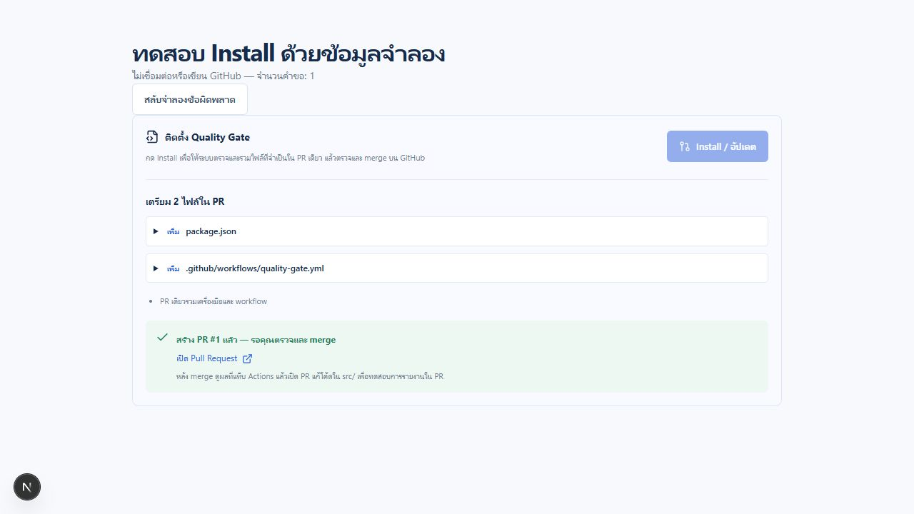

# ติดตั้งครั้งเดียว เก็บเทสต์ใน PR และ AngularJS coverage

## การใช้งานใหม่

เลือก repo → ตั้งค่า AI และ coverage → บันทึก key → กด **Install / อัปเดต**

ปุ่มเดียวเรียกการตรวจไฟล์และสร้าง PR ติดตั้งรวม เครื่องมือทดสอบที่ขาด (ในกรณีที่รองรับ),
workflow และ `config_cov.json` อยู่ใน PR เดียว ไม่มีปุ่ม Force install และไม่มีขั้นตอนให้ merge
PR เตรียมโปรเจกต์แยกก่อน ระบบยังตรวจ dependencies และคงการตั้งค่าเดิมที่ใช้ได้
หากต้อง resolve dependencies เฉพาะโปรเจกต์หรือพบไฟล์เดิมที่ไม่ควรทับ จะหยุดพร้อมเหตุผล
เว็บไม่รัน npm scripts หรือโค้ดของ repository ผู้ใช้

สำหรับ AngularJS แอปยังต้องมี package.json/lockfile ที่ตรงกันและ dependency angular
ตามจริง ชุดเครื่องมือทดสอบแยกอยู่ใน `quality-gate/` ไม่เปลี่ยน dependencies ของแอป
Coverage ใช้เกณฑ์ statements โดยแสดง statements/branches/functions/lines จากการรันจริง
เก็บเกณฑ์เฉพาะไฟล์เดิมใน config ไว้ และปรับเฉพาะ global ตามที่เลือกในเว็บ

## หลัง merge PR ติดตั้ง

1. เปิด PR งานที่เปลี่ยนโค้ดใน `src/` จาก branch ที่อัปเดตแล้ว
2. Action สร้างเทสต์โดยอ่านโค้ดผ่าน API แล้วส่งไปยัง job checks ที่ไม่มี AI key หรือสิทธิ์เขียน
3. Job report เพิ่มเทสต์กลับเข้า PR งานเดิม:
   - JavaScript: `Test/quality-gate/<ชื่อจาก source path>.test.js`
   - AngularJS: `quality-gate/generated.test.cjs`
4. เปิด **Files changed** เพื่อ review ทั้ง source และเทสต์ เทสต์ที่รันไม่ผ่านก็ถูกเก็บให้ตรวจได้
5. Merge PR แล้วไฟล์เทสต์เข้า base branch พร้อมโค้ด ไม่มีการเขียน main โดยตรงหรือ merge อัตโนมัติ

ถ้า branch เปลี่ยนระหว่างตรวจ ระบบจะไม่ force-push ให้รันใหม่กับ commit ล่าสุด
ไม่เขียนไปยัง fork และไม่ทับไฟล์ที่ไม่มีเครื่องหมายว่าเป็นเทสต์ที่ระบบสร้าง
โฟลเดอร์เทสต์ที่ระบบสร้างเป็นพื้นที่ที่ Action จัดการ หากต้องการดูแลเทสต์เองให้เก็บไว้นอกพื้นที่นี้
Workflow ข้าม event จาก GitHub Actions bot เพื่อไม่สร้างเทสต์วนซ้ำ และสร้าง check ชื่อ
**Quality Gate** บน commit ใหม่ ให้ตั้ง branch rules ใช้ check นี้หากต้องการบังคับก่อน merge

## จุดที่เจ้าของระบบควรเช็คบน GitHub จริง

| จุดตรวจ | ผลที่ควรเห็น |
| --- | --- |
| ตั้งค่าการตรวจ | ทั้ง JavaScript/Jest และ AngularJS มี coverage ให้เลือก |
| กด Install | มีสถานะกำลังตรวจและสร้าง PR โดยไม่ต้องกดเตรียมไฟล์แยก |
| PR ติดตั้ง JavaScript ที่ยังไม่มีเครื่องมือ | package.json/lockfile/Jest config พร้อม workflow และ coverage config ใน PR เดียว |
| PR ติดตั้ง AngularJS | workflow, config_cov.json และชุดเครื่องมือ quality-gate/ |
| ข้อมูลเดิมที่ใช้ได้ | scripts, dependencies และ Jest config เดิมไม่ถูกทับโดยไม่จำเป็น |
| ข้อมูลที่เตรียมให้ไม่ได้ | แจ้งเหตุผล ไม่มี PR ที่เขียนทับแบบเดา |
| PR งานหลังติดตั้ง | ไฟล์เทสต์ปรากฏใน Files changed ก่อน merge |
| AngularJS report | มีตัวเลข coverage จริงพร้อมเกณฑ์ และแยกผลเทสต์กับ coverage |
| Artifacts | quality-gate-results มี coverage report; AngularJS มี HTML และ lcov |
| เทสต์ไม่ผ่าน/coverage ต่ำ | รายงาน FAIL หรือไม่พร้อมใช้งาน ไม่อ้างว่าผ่าน |
| มี commit เทสต์จากบอต | ไม่เกิดวงจรสร้างเทสต์ซ้ำ; Quality Gate check อ้างอิง commit ใหม่ |
| Merge PR งาน | เทสต์อยู่ใน main/base branch และรันซ้ำได้ |

GitHub Actions ต้องได้รับ Contents/Checks แบบ write และ Pull requests แบบ write สำหรับ job report
หากองค์กรหรือ branch protection ไม่อนุญาต จะรายงานว่าบันทึกเทสต์/check ไม่สำเร็จ ไม่ข้ามกฎนั้น
ไม่จำเป็นต้องให้ job checks ถือสิทธิ์ดังกล่าว หรือส่ง AI key ไปให้ job checks

## รันเทสต์ที่บันทึกแล้วซ้ำ

JavaScript:

```text
npm ci
npx jest --coverage
```

AngularJS:

```text
npm ci
npm ci --prefix quality-gate
node quality-gate/run.cjs
```

AngularJS เก็บผลใน `coverage/quality-gate/` มี `coverage-summary.json`, `lcov.info`,
`index.html` และ `result.json` โค้ด source ที่ไม่ได้รันยังถูกนับที่ 0% เพื่อไม่ทำให้ coverage สูงเกินจริง
SonarCloud ยังเป็นตัวเลือกเฉพาะ JavaScript

## ผลตรวจในเครื่องและขอบเขต

- UI unit/integration mocks: 59 tests ผ่าน
- Action regression/reporting: 15 tests ผ่าน; AI client: 8 tests ผ่าน
- Pipeline: 5 tests ผ่าน รวม fixture ที่รัน Jest และ AngularJS/jsdom จริง
- Fixture ตรวจทั้ง coverage ครบ/ไม่ครบ, เทสต์ล้มเหลว, source ที่ไม่ถูกเรียก และการรันเทสต์ที่เก็บใน repo ซ้ำ
- GitHub mutations ใช้ mocks ตรวจ stale head, fork, default branch, ownership, retry/no-op และ non-fast-forward
- ทดสอบปุ่ม Install ใน browser ทั้งสำเร็จและผิดพลาดด้วยข้อมูลจำลอง หน้าทดสอบถูกนำออกจาก product แล้ว



ยังต้องทดลองด้วย GitHub App, keys และ repository ทดลองของเจ้าของบัญชีจริงก่อน rollout
การทดสอบ fixture ไม่ใช่หลักฐานว่าโมเดลทุกตัวหรือ repo ผู้ใช้จะผ่าน

## การเผยแพร่และย้อนกลับ

เว็บตรึง Action ด้วย commit ใน `src/lib/config.ts` และตรวจว่าพบบน GitHub ก่อนสร้าง PR
รุ่นที่เว็บอ้างอิงคือ `2f75838610968e9183e5c2eeb4b9433011d1dd66` ซึ่งเผยแพร่บน
`main` ของ Action แล้ว หากเผยแพร่รุ่นอื่นด้วย squash/rebase จน SHA เปลี่ยน
ต้องอัปเดต `engineRef` ให้ตรง SHA ที่มี source และ bundle นี้ แล้วทดสอบอีกครั้ง
ต้องเผยแพร่ source พร้อม `dist/index.js` ของ Action commit ใหม่นั้นก่อนใช้งาน ส่วน repo
ที่ติดตั้งแล้วต้องกด Install / อัปเดต และ merge PR ใหม่ ไม่มีการเปลี่ยน workflow เดิมอัตโนมัติ

ก่อนงานรอบนี้: UI `7e2be480acdcba671cca65d27cec515a08387df5`,
Action `3d88cb218b4fa1ea2db009ab1531b9c332b52ffe` งานเดิมใน src/math.js,
src/security_vulnerable.js และ src/utility.js ของ Action ไม่รวมในงานนี้
หากย้อนเวอร์ชันหลังติดตั้งแล้ว ต้องย้อน workflow ของ consumer repo ด้วย และพิจารณาไฟล์เทสต์
ที่ merge ไปแล้วแยกต่างหาก ไม่ลบเทสต์ผู้ใช้โดยอัตโนมัติ
